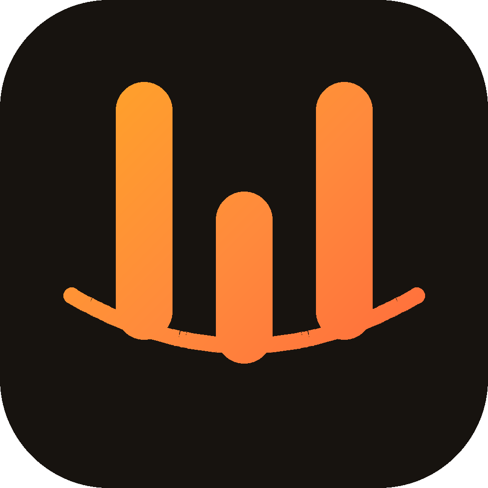

<p align="center">
  
</p>

<h1 align="center">Voxflow</h1>

<p align="center">
  Free and open source Mac dictation app — speak anywhere, get clean, structured text.
</p>

<p align="center">
  <a href="https://github.com/raphaelaxiom/voxflow/releases/latest/download/Voxflow.dmg"><b>⬇ Download Voxflow.dmg</b></a><br>
  <sub>Works on all Macs (Apple Silicon + Intel)</sub>
</p>

---

## Overview

Voxflow is a free Mac dictation app. Hold a key to talk, or tap to toggle dictation, and your words are transcribed and polished into clean, well-structured text — with headings and lists when the content calls for them — then pasted into whatever text field has focus.

It uses Google Gemini for both transcription and polish, and works in any app. If the cursor isn't in a text field when dictation finishes, nothing is lost: the dictation is saved to your history and a pill pops up — "Text not pasted. Click here to copy text."

## Quick Start

1. Download [Voxflow.dmg](https://github.com/raphaelaxiom/voxflow/releases/latest/download/Voxflow.dmg), open it, and drag Voxflow to Applications.
2. Get a free Gemini API key from [Google AI Studio](https://aistudio.google.com/apikey).
3. Launch Voxflow and follow Setup: paste your Gemini API key and grant Microphone, Accessibility, and (optionally) Screen Recording permissions.
4. Hold **Fn** to talk, or tap **⌘ Fn** to start and stop dictation.

## Features

- **Gemini-first pipeline** — Gemini transcribes your speech and polishes it, returning text with layout (headings, bullets, structure) as appropriate for the content.
- **Language preservation** — if you speak Hinglish (Roman Hindi–English mix), the output stays Hinglish in Roman script. No Devanagari conversion, no forced English.
- **Dashboard** — every dictation saved to a searchable history with click-to-copy, delete, and clear. Real stats: words today, total words, words per minute, and day streak.
- **Paste-fail safety net** — dictations are saved even when paste fails, with a click-to-copy pill.
- **Hold-to-talk and toggle dictation**, plus a copy-again shortcut.
- **Edit mode** — select text and speak to transform it.
- **Voice macros** — spoken commands that paste predefined text.
- **Custom vocabulary** — names and terms transcribed the way you spell them.
- **Notetaker, Dictionary, Snippets, Style presets, Transforms, Scratchpad** — all in the dashboard.
- **Context-aware cleanup** — optional on-screen context helps fix names and terms.
- **Menu-bar app** — quiet, fast, no dock icon. Auto-updates from GitHub releases.
- **Privacy first** — no Voxflow server. Only API calls to your configured providers leave your Mac. No telemetry.

## Configuration

Voxflow talks to any OpenAI-compatible provider. The default is Gemini:

- Base URL: `https://generativelanguage.googleapis.com/v1beta/openai`
- Transcription model: `gemini-2.5-flash`
- Polish model: `gemini-2.5-flash`

To use a different provider (e.g. Groq, Ollama, LM Studio), open Settings → API Key → Advanced Provider Settings and enter that provider's base URL, key, and model IDs.

## Development

```sh
make check   # typecheck + tests + validation (requires macOS)
make         # build the universal app into build/
make dmg     # build Voxflow.dmg
```

Voxflow is pure Swift (no Xcode project, no SwiftPM) and targets macOS 13+.

## Credits

- Created by **Raphael Axiom**
- Developed by **DKH Verse**
- Voxflow is a fork of [FreeFlow](https://github.com/zachlatta/freeflow), created by Zach Latta, and is licensed under the [MIT license](LICENSE). The original `Copyright (c) 2026 Zach Latta` notice is retained in `LICENSE`.
